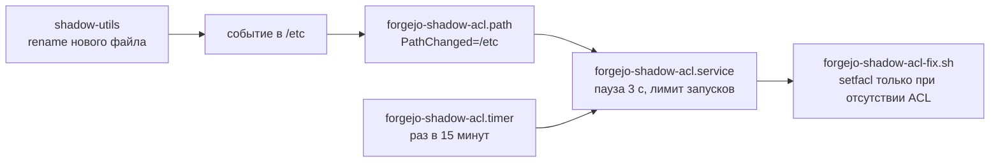

# Операторская инструкция

## Область

Инструкция описывает сборку и установку `forgejo` из COPR
`nos1609/forgejo-pam`. Она не разрешает изменение боевого сервера сама по себе.

## Подготовка

1. Проверьте дистрибутив и архитектуру.
2. Зафиксируйте установленный NVR и состояние службы.
3. Сохраните согласованную резервную копию базы Forgejo и `app.ini`.
4. Подготовьте предыдущий RPM и точные команды восстановления.
5. Остановите запись в базу перед резервным копированием и обновлением.

Проверьте текущее состояние:

```bash
rpm -q forgejo
systemctl status forgejo --no-pager
```

## Порядок изменений

Статус на 23 октября 2026 года: на GitHub ruleset `protect-main` закрывает
прямую запись, удаление и переписывание истории `main`. Merge возможен только
через PR после проверок `Analyze GitHub Actions`, `CodeQL` и `CodeRabbit` и
разрешения всех обсуждений; администратор обходит проверки только внутри PR.
Ruleset `protect-rawhide-history` запрещает удаление и переписывание `rawhide`:
эта ветка повторяет `main` и обновляется только перемоткой вперёд.

1. Создайте ветку от `main`: `update/<версия>`, `docs/<тема>`, `chore/<тема>`.
2. Доведите изменения в первичном Forgejo: опубликуйте ветку в `origin`,
   выполните локальные проверки, при изменении spec соберите SRPM.
3. Опубликуйте ветку в GitHub и откройте PR в `main`. CodeRabbit в открытом
   репозитории запускается комментарием `@coderabbitai review`.
4. Исправьте замечания, разрешите обсуждения, дождитесь проверок.
5. Выберите способ merge:
   - перенос версии из Fedora — merge commit: он сохраняет merge commit со
     стратегией `ours`, без которого `rpmautospec` обрывает changelog;
   - остальные изменения — squash. При squash сообщение коммита берётся из
     описания PR; если изменение не касается пакета, добавьте в описание строку
     `[skip changelog]`.
6. Перемотайте `rawhide` на GitHub и обе ветки в Forgejo до нового `main`:

   ```bash
   git fetch github
   git push github github/main:refs/heads/rawhide
   git push origin github/main:refs/heads/main github/main:refs/heads/rawhide
   ```

   Без `--force`: push, который не является перемоткой, должен завершиться
   ошибкой.
7. Запустите сборку в COPR.

## Перенос новой версии из Fedora dist-git

Версия Forgejo приходит из веток `rawhide` и `f45` Fedora dist-git. Обычный
`git merge` даёт merge commit, дерево которого отличается от обоих родителей:
`rpmautospec` не проходит через такой коммит и обрывает `%autochangelog` записью
`RPMAUTOSPEC: unresolvable merge`. Поэтому перенос выполняется двумя коммитами:

1. merge commit со стратегией `ours` записывает историю Fedora; его дерево равно
   прежнему `main`, строка `[skip changelog]` убирает его из changelog;
2. обычный коммит переносит изменения Fedora на PAM-дельту.

```bash
git fetch upstream rawhide
base=$(git merge-base main upstream/rawhide)
git switch -c update/<версия> main
git merge -s ours \
  -m "Merge Fedora dist-git history up to $(git rev-parse --short upstream/rawhide)" \
  -m "[skip changelog]" upstream/rawhide
git diff "$base" upstream/rawhide | git apply --3way --index
```

`git apply` завершается с кодом 1 из-за конфликта в `forgejo.spec`. Оставьте
`Version:` из Fedora и `Release: %autorelease -e pam1`, затем:

```bash
git add forgejo.spec
git commit -m "Update to <версия>"
rpmautospec calculate-release forgejo.spec
rpmautospec generate-changelog forgejo.spec | head
```

Ожидаемый результат в ветке: release `1.pam1` и changelog без записи
`unresolvable merge`. После merge PR release станет `2.pam1`: merge commit PR
тоже считается коммитом. Дальше ветка идёт по разделу «Порядок изменений».

Версия 15.0.10 перенесена 23 октября 2026 года коммитами `eeb5a96` и `764bcd1`
напрямую в `main`, без PR; ретроспективное ревью — PR #2. Рецепт проверен на
копии репозитория, дерево совпало с `764bcd1`.

Коммиты для публичного GitHub подписывайте адресом GitHub noreply, а не личным
email. Сверьте адрес автора с уже опубликованными коммитами до `git push`.

## Сборка в COPR

COPR не получает webhook: после публикации `main` запустите сборку вручную. На
хосте с подключённым репозиторием COPR и `dnf-automatic` опубликованная сборка
устанавливается автоматически, поэтому запуск сборки и есть момент выпуска.

Проект поддерживает два chroot:

- `epel-10-x86_64`;
- `fedora-45-x86_64`.

Запустите сборку сохранённого SCM package:

```bash
copr-cli build-package forgejo-pam \
  --name forgejo \
  --chroot epel-10-x86_64 \
  --chroot fedora-45-x86_64
```

Считайте сборку успешной только после статуса `succeeded` для каждого chroot,
`Child return code was: 0` и наличия ожидаемых RPM в result metadata.

## Подключение репозитория

```bash
sudo dnf copr enable nos1609/forgejo-pam
dnf --showduplicates list forgejo
```

Проверьте, что выбран NVR с суффиксом `pam1` и правильным dist tag. Затем
установите или обновите пакет отдельной согласованной командой.

## Проверка RPM до установки

```bash
rpm -qp --requires ./forgejo-*.rpm | grep -E 'libpam|pam'
rpm -qpl ./forgejo-*.rpm | grep -E '20-pam-caps|forgejo_chkpwd_fix|forgejo-init'
rpmkeys --checksig ./forgejo-*.rpm
```

Проверку подписи выполняйте с ключом конкретного COPR-проекта в отдельном RPM
keyring или после штатного подключения репозитория.

## Проверка после установки

```bash
forgejo --version
ldd /usr/bin/forgejo | grep libpam
systemctl cat forgejo
systemctl show forgejo -p AmbientCapabilities
getfacl -cp /etc/shadow | grep '^user:forgejo:r--'
semodule -l | grep '^forgejo_chkpwd_fix'
systemctl is-active forgejo-shadow-acl.path forgejo-shadow-acl.timer
journalctl -u forgejo -b --no-pager
```

Отдельно проверьте PAM-вход, обычный вход, git-over-HTTP, git-over-SSH и Actions.
Не помещайте пароль, OTP, cookie, приватный ключ и содержимое `app.ini` в журнал
приёмки.

## Защита ACL `/etc/shadow` на хосте

Статус на 23 октября 2026 года: установлена и проверена на одном хосте EL10 с
systemd 257. В RPM не входит, ставится на хост отдельно из
[`contrib/forgejo-shadow-acl/`](../contrib/forgejo-shadow-acl/).

### Зачем

PAM-вход читает `/etc/shadow` через ACL `u:forgejo:r`, который ставит `%post`.
Утилиты shadow-utils (`useradd`, `usermod`, `userdel`, `passwd`, `chpasswd`) не
правят `/etc/shadow` на месте: они пишут новый файл и подменяют старый через
`rename`. У нового файла ACL нет, и PAM-вход перестаёт работать до следующей
установки пакета.

Наблюдение за самим файлом (`PathChanged=/etc/shadow`) эту подмену не видит.
По `systemd.path(5)` `PathChanged=` срабатывает, когда закрывается файл,
открытый на запись; замена через `rename` к этому не относится. Юнит такого вида
не сработал на хосте ни разу, хотя `/etc/shadow` менялся.

### Устройство



- Path unit следит за каталогом `/etc` и срабатывает на подмену, `setfacl` и
  `setfacl -b` у дочерних файлов.
- Timer раз в 15 минут запускает тот же service на случай пропущенного события
  inotify.
- `ExecStartPre=/usr/bin/sleep 3` сливает всплеск событий в один запуск:
  события во время паузы входят в текущий запуск, проверка идёт после неё.
- `StartLimitBurst=10` за 10 секунд выше достижимой частоты, около трёх запусков.
  По `systemd.path(5)` превышение лимита service переводит path unit в failed, и
  он перестаёт следить.
- `ConditionPathExists=` на маркер пакета в `/var/lib/rpm-state/forgejo/`: после
  удаления пакета ACL не возвращается.
- `Nice=19`, `IOSchedulingClass=idle` и `LogLevelMax=notice`: холостые запуски
  не пишутся в журнал, восстановление пишется с уровнем `warning`.
- Скрипт меняет ACL, только если записи нет. Собственный `setfacl` тоже событие
  в `/etc`; без этой проверки path unit запускал бы service по кругу.

### Установка

```bash
sudo install -m 0644 -o root -g root \
  contrib/forgejo-shadow-acl/forgejo-shadow-acl.path \
  contrib/forgejo-shadow-acl/forgejo-shadow-acl.service \
  contrib/forgejo-shadow-acl/forgejo-shadow-acl.timer \
  /etc/systemd/system/
sudo install -m 0755 -o root -g root \
  contrib/forgejo-shadow-acl/forgejo-shadow-acl-fix.sh /usr/local/sbin/
sudo restorecon -v /etc/systemd/system/forgejo-shadow-acl.* \
  /usr/local/sbin/forgejo-shadow-acl-fix.sh
sudo systemd-analyze verify /etc/systemd/system/forgejo-shadow-acl.service \
  /etc/systemd/system/forgejo-shadow-acl.path \
  /etc/systemd/system/forgejo-shadow-acl.timer
sudo systemctl daemon-reload
sudo systemctl enable --now forgejo-shadow-acl.path forgejo-shadow-acl.timer
```

Если path unit уже был запущен со старой конфигурацией, выполните
`sudo systemctl restart forgejo-shadow-acl.path`.

### Проверка

```bash
systemctl is-active forgejo-shadow-acl.path forgejo-shadow-acl.timer
systemctl list-timers forgejo-shadow-acl.timer --no-pager
sudo getfacl -cp /etc/shadow | grep '^user:forgejo:r'
```

Контрольное снятие ACL. PAM-вход недоступен около трёх секунд:

```bash
sudo setfacl -x u:forgejo /etc/shadow
sleep 5
sudo getfacl -cp /etc/shadow | grep '^user:forgejo:r'
sudo journalctl -u forgejo-shadow-acl.service -p warning --since -1min --no-pager
```

Ожидается запись `user:forgejo:r--` и строка
`reapplied u:forgejo:r on /etc/shadow`. Если ACL не вернулся, восстановите его
командой `sudo setfacl -m u:forgejo:r /etc/shadow` и перейдите к диагностике.

Результат 23 октября 2026 года: ACL вернулся через 3,2 секунды. Создание и
удаление файла в `/etc`, подмена через `rename`, 500 `touch` подряд и 300 `touch`
с интервалом 5 мс дали по одному запуску service; path unit остался `active`.

### Диагностика

```bash
systemctl status forgejo-shadow-acl.path forgejo-shadow-acl.service --no-pager
ls -l /var/lib/rpm-state/forgejo/shadow-acl-owned
```

- `trigger-limit-hit` или `unit-start-limit-hit` у path unit: он перестал
  следить, timer продолжает проверку. Верните наблюдение:
  `sudo systemctl reset-failed forgejo-shadow-acl.path forgejo-shadow-acl.service`
  и `sudo systemctl restart forgejo-shadow-acl.path`.
- `ConditionPathExists=` не выполнено: маркера пакета нет, ACL пакету не
  принадлежит. Ставить ACL вручную в этом случае не нужно.

### Откат

```bash
sudo systemctl disable --now forgejo-shadow-acl.timer forgejo-shadow-acl.path
sudo rm /etc/systemd/system/forgejo-shadow-acl.path \
  /etc/systemd/system/forgejo-shadow-acl.service \
  /etc/systemd/system/forgejo-shadow-acl.timer \
  /usr/local/sbin/forgejo-shadow-acl-fix.sh
sudo systemctl daemon-reload
```

Текущий ACL после отката остаётся; следующая правка учётных записей его снимет.

### Источники

- `systemd.path(5)`, `systemd.unit(5)`, `systemd.exec(5)` и `systemd.timer(5)`
  из пакета `systemd` RHEL 10; проверено на `systemd-257`.
- [A brief introduction to path units](https://www.redhat.com/en/blog/introduction-path-units),
  Red Hat: path units ловят не все события, последовательность операций нужно
  проверять.
- Руководство RHEL 10
  [Using systemd unit files to customize and optimize your system](https://docs.redhat.com/en/documentation/red_hat_enterprise_linux/10/html-single/using_systemd_unit_files_to_customize_and_optimize_your_system/index)
  path units не описывает, timer упоминает только в списке типов.

## Откат

1. Остановите службу Forgejo.
2. Установите подготовленный предыдущий RPM.
3. Восстановите совместимые базу данных и `app.ini` из одной резервной копии.
4. Выполните `systemctl daemon-reload`.
5. Запустите службу и повторите проверки версии, журнала и основных протоколов.

Не считайте `dnf downgrade` полным откатом после миграции базы. Не удаляйте ACL
вручную, пока не установлено, что он принадлежит этому пакету.
